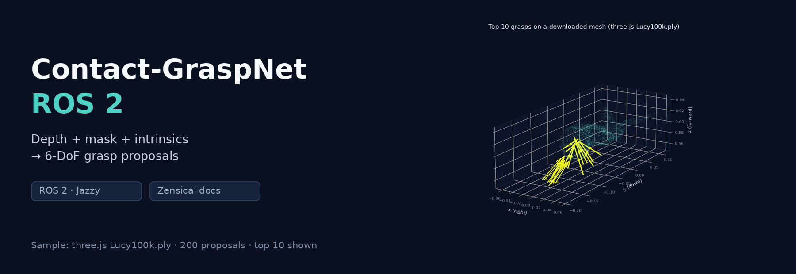

# Contact-GraspNet ROS 2

[](https://sattwik-sahu.github.io/contact_graspnet_ros/)
[](https://sattwik-sahu.github.io/contact_graspnet_ros/agent-guide/)
[](https://github.com/sattwik-sahu/contact_graspnet_ros/actions/workflows/docs.yml)
[](https://github.com/sattwik-sahu/contact_graspnet_ros/actions/workflows/docker.yml)
[](https://docs.ros.org/en/jazzy/)
[](https://www.python.org/)



A modular, Dockerized ROS 2 wrapper for
[Contact-GraspNet](https://github.com/elchun/contact_graspnet_pytorch).

**Documentation:** https://sattwik-sahu.github.io/contact_graspnet_ros/

```text
GenerateGrasps service request
  depth + camera_info + optional mask
        │
        ▼
rclpy service  ──►  typed PyTorch engine  ──►  GraspProposalArray
```

The wrapper is **service-only**; there are no sensor-topic subscriptions or
output streams.

## Quick start

```bash
git clone --recurse-submodules git@github.com:sattwik-sahu/contact_graspnet_ros.git
cd contact_graspnet_ros
pixi install -e jazzy
pixi run -e jazzy build
pixi run -e jazzy test
```

Start the Zenoh router and node:

```bash
pixi run -e jazzy zenohd    # terminal 1
pixi run -e jazzy launch    # terminal 2
```

Call the service:

```bash
pixi run -e jazzy python scripts/call_grasp_service.py \
  --input third_party/contact_graspnet_pytorch/test_data/7.npy \
  --segmap-id 1
```

## Packages

| Package | Purpose |
|---|---|
| `contact_graspnet_msgs` | Grasp messages and the `GenerateGrasps` service |
| `contact_graspnet_ros` | rclpy node + ROS-free typed PyTorch engine |

Configuration is in [`config/`](config/), Docker assets in
[`docker/`](docker/), and the documentation source in [`docs/`](docs/).

## Documentation

The site is built with [Zensical](https://zensical.org/) from `zensical.toml`.

- [Getting Started](https://sattwik-sahu.github.io/contact_graspnet_ros/getting-started/)
- [Example Output](https://sattwik-sahu.github.io/contact_graspnet_ros/example-output/)
- [Configuration](https://sattwik-sahu.github.io/contact_graspnet_ros/configuration/)
- [Grasp Frames & Downstream Planning](https://sattwik-sahu.github.io/contact_graspnet_ros/grasp-frames/)
- [ROS Interfaces](https://sattwik-sahu.github.io/contact_graspnet_ros/ros-interfaces/)
- [Docker & Docker Compose](https://sattwik-sahu.github.io/contact_graspnet_ros/docker/)
- [Deployment](https://sattwik-sahu.github.io/contact_graspnet_ros/deployment/)
- [Contributing](https://sattwik-sahu.github.io/contact_graspnet_ros/contributing/)
- [Agent Guide](https://sattwik-sahu.github.io/contact_graspnet_ros/agent-guide/)

## For AI agents

Read [`AGENTS.md`](AGENTS.md) at the repository root before making changes. It
contains the repo map, non-negotiable rules, key APIs, commands and gotchas.
The same guidance is published as the
[Agent Guide](https://sattwik-sahu.github.io/contact_graspnet_ros/agent-guide/)
for humans.

## License

Wrapper code: Apache-2.0. The vendored PyTorch port and weights retain the
upstream NVIDIA license; see
[`third_party/NOTICE`](third_party/NOTICE) and
[`docs/license.md`](docs/license.md).
