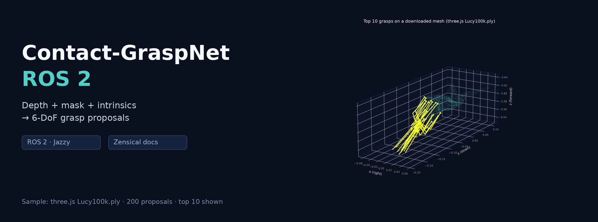
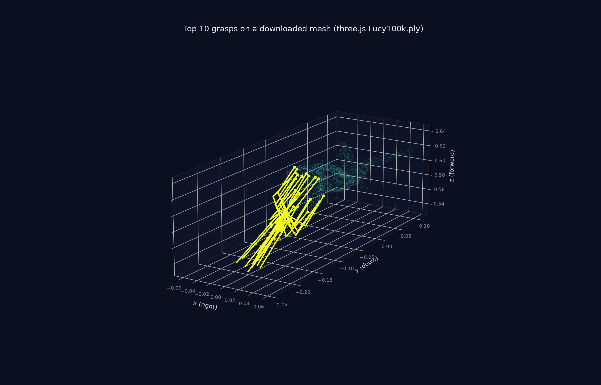

# Example Output



This page shows a real run of the ROS-free `ContactGraspNetEngine` on a mesh
downloaded from the internet. The point cloud, top grasp poses and contact
points are plotted in the camera optical frame; the same figure is used for the
README banner.

## Result



The teal points are the sampled mesh surface. Each numbered grasp is drawn as
a parallel-jaw gripper: two finger lines separated by the predicted opening
(`width`), a base bar between them, a wrist stem behind the base, and a small
arrow showing the approach direction (`+Z`). Colour encodes grasp score.

For this run a 1.9 MB PLY mesh (`Lucy100k.ply` from the three.js example models)
was downloaded, 20 000 surface points were sampled, and the engine returned
200 proposals in about 2.3 s on a CUDA GPU. The same model and selection code
is used by the `generate_grasps` service — see
[Inference Contract](inference-contract.md) for the output semantics.

## Reproduce it

Generate the grasp data (requires the Pixi environment and the checkpoint):

```bash
pixi run -e jazzy python scripts/demo_from_mesh.py \
  --output /tmp/grasps.npz
```

Render the 3-D plot and the banner (requires `matplotlib` and `Pillow`):

```bash
pip install -r docs-requirements.txt
python scripts/render_banner.py --input /tmp/grasps.npz
```

Both images are written to `docs/assets/`. Use `--mesh` on the first command to
try a different public `.ply`/`.obj` URL or a local file, and `--caption` on the
second command to label it in the figure.

!!! note
    The demo uses the ROS-free engine directly. The service path additionally
    converts a depth image and mask into point clouds and can transform the
    output into your planning frame; see
    [Grasp Frames and Downstream Planning](grasp-frames.md).
